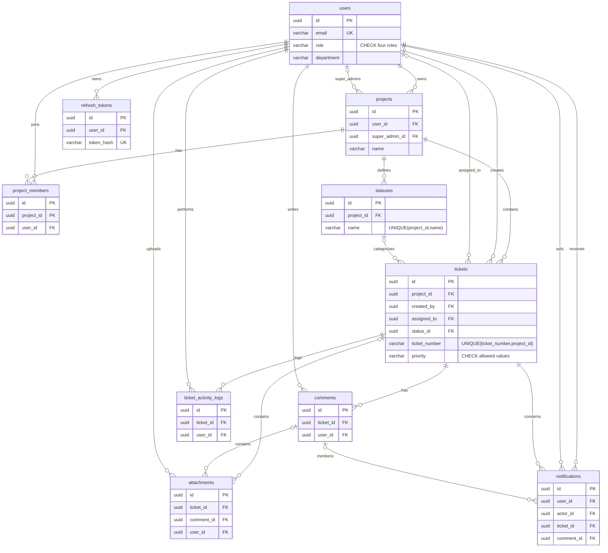

# Ticketing system: ER diagram and relational schema

The diagram reflects the ten PostgreSQL tables in `backend/prisma/schema.prisma`. A project owns statuses and tickets; a ticket has one creator and an optional assignee. Redis stores temporary dashboard and summary documents, outside the relational model.

## Relational schema

| Relation | Primary key | Foreign keys | Other constraints |
|---|---|---|---|
| `users` | `id` | — | `email` UNIQUE; `role` CHECK (`SuperAdmin`, `Admin`, `Editor`, `User`); required name, email, password hash, role |
| `projects` | `id` | `user_id → users.id`; `super_admin_id → users.id` | required name and owner |
| `project_members` | `id` | `project_id → projects.id`; `user_id → users.id` | (`project_id`, `user_id`) UNIQUE |
| `statuses` | `id` | `project_id → projects.id` | (`project_id`, `name`) UNIQUE |
| `tickets` | `id` | `project_id → projects.id`; `created_by`, `assigned_to → users.id`; `status_id → statuses.id` | (`ticket_number`, `project_id`) UNIQUE; `priority` CHECK; trigger verifies status is in the same project |
| `comments` | `id` | `ticket_id → tickets.id`; `user_id → users.id` | required text |
| `attachments` | `id` | `ticket_id → tickets.id`; `comment_id → comments.id`; `user_id → users.id` | required file name and URL |
| `ticket_activity_logs` | `id` | `ticket_id → tickets.id`; `user_id → users.id` | action may be null |
| `notifications` | `id` | `user_id`, `actor_id → users.id`; `ticket_id → tickets.id`; `comment_id → comments.id` | `is_read` defaults false |
| `refresh_tokens` | `id` | `user_id → users.id` | `token_hash` UNIQUE; expiry required |

`backend/demo/schema.sql` is the complete executable PostgreSQL DDL generated from Prisma. `backend/demo/advanced.sql` adds CHECK constraints, the status guard trigger, and a reporting function. The SQL role demonstration in `run-demo.mjs` grants a read-only role access to selected tables and verifies that INSERT is denied. The application itself uses JWT roles in Express middleware and a shared database connection; its database role demonstration is separate from application sessions.
